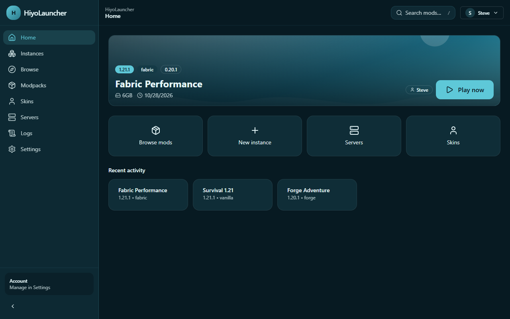
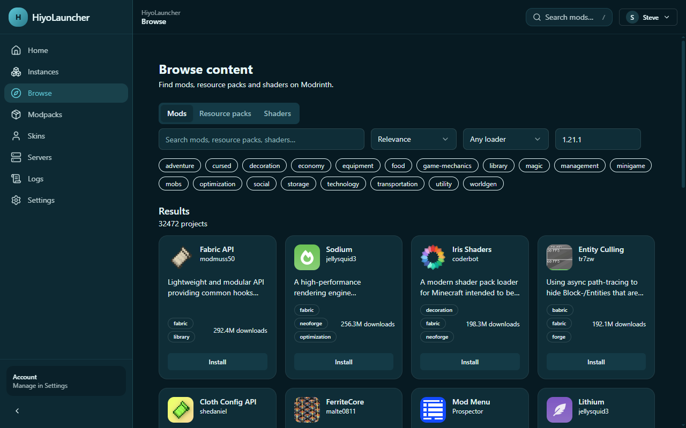
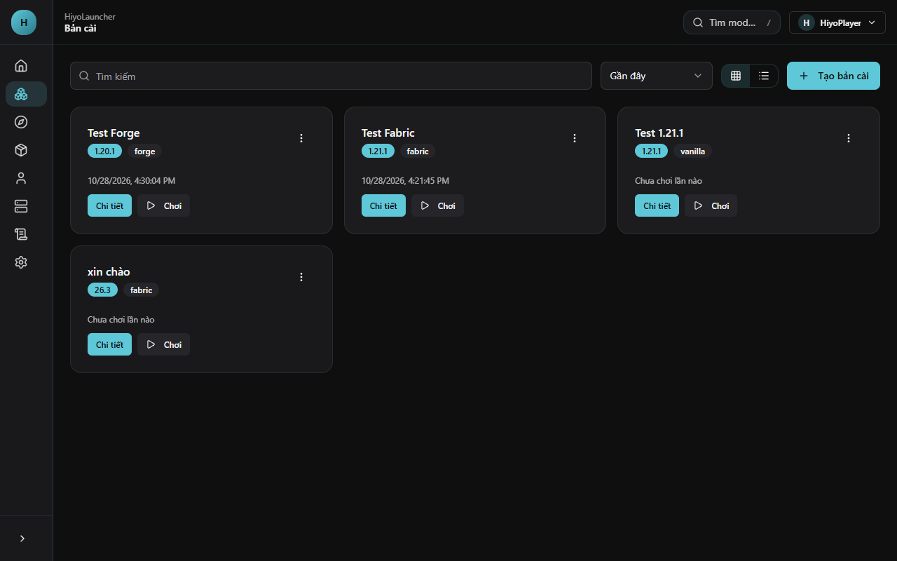
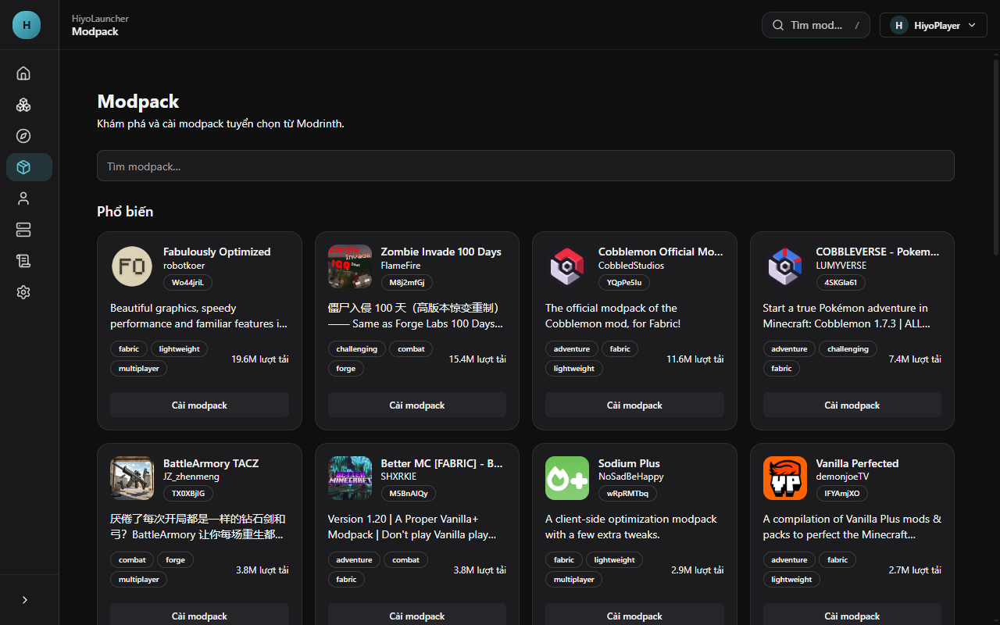
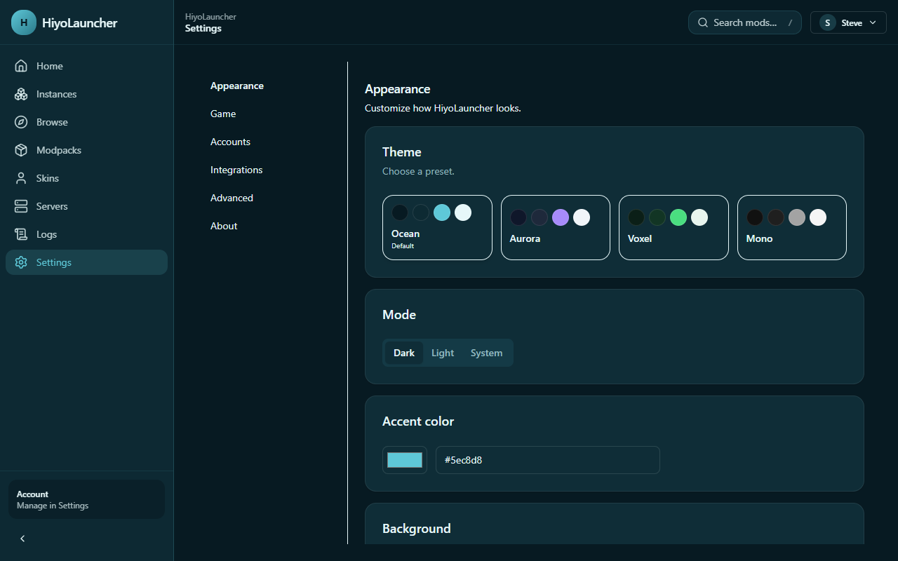
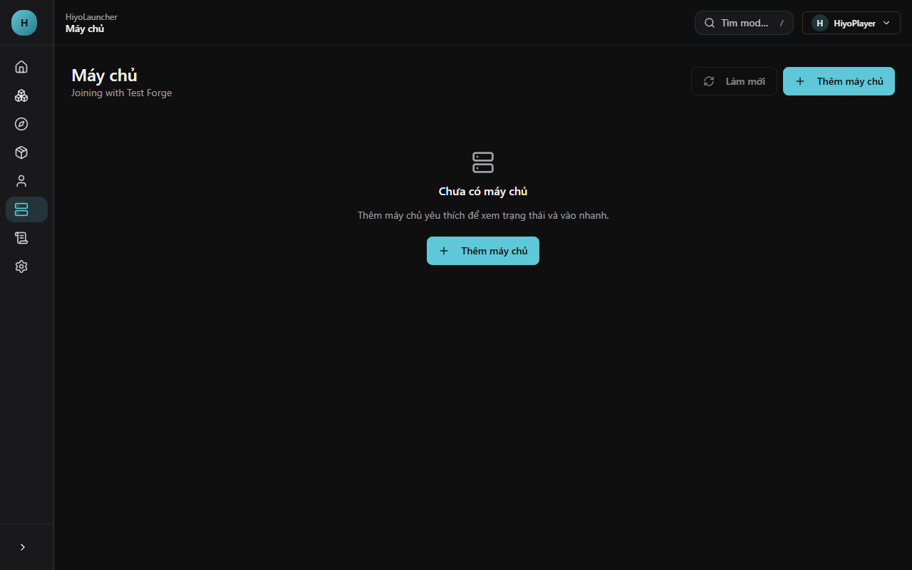

# HiyoLauncher

<p align="center">
  
</p>

<p align="center">
  
</p>

<p align="center">
  <strong>A fast, beautiful and personalizable Minecraft launcher with Modrinth built in.</strong>
</p>

<p align="center">
  <a href="README.md">English</a> · <a href="README_vi.md">Tiếng Việt</a> · <a href="https://hiyo412012.github.io/HiyoLauncher/">Website</a>
</p>

<p align="center">
  <a href="LICENSE"></a>
  <a href="https://github.com/hiyo412012/HiyoLauncher/actions/workflows/ci.yml"></a>
  <a href="https://github.com/hiyo412012/HiyoLauncher/releases"></a>
</p>

> **HiyoLauncher is not affiliated with Mojang Studios, Microsoft, or Modrinth.** Minecraft is a trademark of Mojang Studios. Modrinth is a trademark of its respective owners.

---

## Features

| Area | What you get |
|---|---|
| Fast & stable | Instant UI feedback, parallel downloads, SHA1 verification, atomic installs, retry with backoff, repair instance, crash diagnostics |
| Modrinth content | Search & install mods, modpacks, shaders and resource packs directly from Modrinth, with dependency resolution and one-click updates |
| Mod loaders | Fabric, Quilt, Forge and NeoForge installers, matched to your Minecraft version |
| Accounts | Microsoft login via device code, plus offline accounts for offline/LAN servers (with disclaimer) |
| Personalization | Pastel Ocean default theme, light/dark modes, custom accent, backgrounds, density, font scale, language (Vietnamese/English), per-instance covers |
| Crash diagnostics | Recognizes OutOfMemoryError, Java version mismatches, missing/duplicate mods, GLFW/OpenGL errors and gives actionable tips |
| Discord Rich Presence | Optional presence showing your instance and version |
| Auto-update | In-app updates via GitHub releases |

## Screenshots

| Home | Browse |
|---|---|
|  |  |

| Instances | Modpacks |
|---|---|
|  |  |

| Settings | Servers |
|---|---|
|  |  |

> Screenshots use the default **Pastel Ocean** theme and the English UI. Themes, accent colors, density and backgrounds are fully customizable.

## Download & install

Grab the latest build from the [Releases page](https://github.com/hiyo412012/HiyoLauncher/releases).

| Platform | Format |
|---|---|
| Windows (x64) | NSIS installer (`.exe`) |
| macOS (x64 / arm64) | DMG (`.dmg`) — builds are currently **unsigned** |
| Linux (x64) | AppImage (`.AppImage`) and Debian package (`.deb`) |

### Quick start

1. Download and install the build for your OS.
2. Launch HiyoLauncher. Complete onboarding: pick a language, a game folder, a theme, and create your first instance.
3. Choose an account (Microsoft or offline) and press **Play**.

### Dev setup

```bash
git clone https://github.com/hiyo412012/HiyoLauncher.git
cd HiyoLauncher
npm install
npm run dev        # start in dev mode
npm test           # run unit tests
npm run typecheck  # type-check
npm run dist:win   # build Windows installer
```

Other build commands: `npm run build`, `npm run dist`, `npm run dist:mac`, `npm run dist:linux`.

### Build matrix (CI)

| OS | Node | Steps |
|---|---|---|
| ubuntu-latest | 24 | `npm ci` → `npm run typecheck` → `npm test` → `npm run build` |
| windows-latest | 24 | `npm ci` → `npm run typecheck` → `npm test` → `npm run build` |
| macos-latest | 24 | `npm ci` → `npm run typecheck` → `npm test` → `npm run build` |

Release builds additionally run `npx electron-builder --publish always` for Windows (NSIS), macOS (DMG, x64+arm64) and Linux (AppImage + deb).

## Microsoft login setup

HiyoLauncher uses the **Microsoft device code flow** with a **public client** (no secret). You need an Azure app registration client ID:

- Step-by-step guide: [`docs/microsoft-auth.md`](docs/microsoft-auth.md)
- Paste your client ID in **Settings → Advanced → Microsoft client ID**, or set the `MS_CLIENT_ID` environment variable.

Offline mode works without any client ID.

## Offline mode disclaimer

Offline accounts are intended for **offline and LAN servers** and for users who already own Minecraft. HiyoLauncher does **not** ship any Minecraft game assets and does not bypass Minecraft ownership for online servers. See [`docs/offline-mode.md`](docs/offline-mode.md).

## Project structure

```
src/
  shared/        # types, IPC contract, zod schemas, constants
  main/          # Electron main process (Node): services + IPC
  preload/       # typed contextBridge API
  renderer/      # React app
tests/           # Vitest unit/component tests
docs/            # documentation
.github/         # CI workflows and templates
```

## Roadmap

Roadmap items below are **planned**, not yet shipped unless marked.

- M1 Scaffold, IPC, settings, theme shell, onboarding
- M2 Instance CRUD, vanilla install, Java, launch, log streaming
- M3 Auth: Microsoft + offline accounts
- M4 Mod loaders: Fabric, Quilt, Forge, NeoForge
- M5 Modrinth mods + content management
- M6 Modpacks (`.mrpack`)
- M7 Shaders, resource packs, skins, servers
- M8 Crash diagnostics, Discord RPC, auto-updater
- M9 Tests, CI, docs, release (v1.0.0)

## Contributing

See [`CONTRIBUTING.md`](CONTRIBUTING.md). Please open issues using the provided templates and never commit secrets.

## License

[MIT](LICENSE) © 2026 HiyoLauncher contributors.

---

**[Đọc bằng tiếng Việt →](README_vi.md)**
